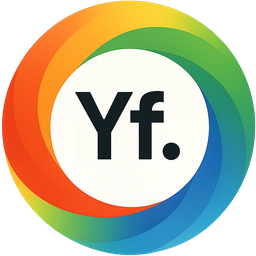

<p align="center">
  
</p>

<h1 align="center">yldfi</h1>

<p align="center">
  Automated yield vaults on Ethereum
</p>

<p align="center">
  <a href="https://yldfi.co">Website</a> •
  <a href="https://docs.yldfi.co">Docs</a> •
  <a href="https://x.com/yld_fi">X.com</a> •
  <a href="https://github.com/yldfi">GitHub</a>
</p>

---

## About

yldfi provides automated yield vaults built on Yearn V3's tokenized strategy architecture, following the ERC-4626 standard. Deposit your tokens and earn auto-compounding returns without manual intervention.

## Development

```bash
# Install dependencies
pnpm install --frozen-lockfile

# Run development server
pnpm dev

# Build for production
pnpm build
```

Checks that are safe to run locally:

```bash
pnpm lint
pnpm type-check
pnpm test:unit
```

See `AGENTS.md` for the full guide, including the test commands that call live, paid upstream services and should not be run locally.

## Deployment

Deployed to Cloudflare Workers using OpenNext. Merging to `main` deploys the site Worker (`yldfi`) and the vault cache Worker (`yldfi-cache`) automatically through GitHub Actions.

The manual equivalent of the site deploy is:

```bash
pnpm run deploy
```

That builds for Cloudflare, populates the static-assets cache and then runs the Worker deploy. Use `pnpm run deploy`, not `pnpm deploy` — the latter is pnpm's own built-in command.

The third Worker, `yldfi-x-weekly-apy` (the weekly X post), is deployed by hand; see `workers/README-x-weekly-apy.md`. `AGENTS.md` has the full deploy map.

## Environment Variables

Copy `.env.example` to `.env.local` and fill in your values:

```bash
cp .env.example .env.local
```

## License

MIT
